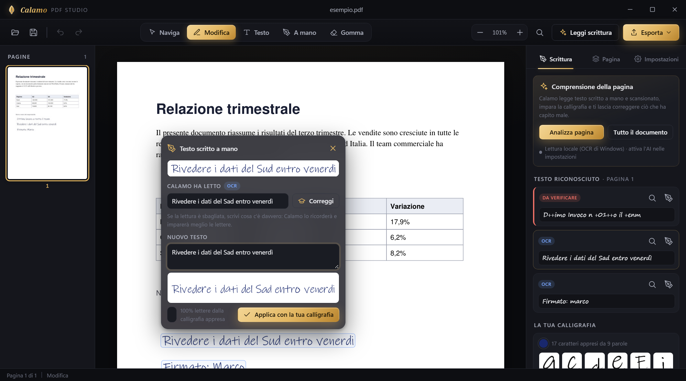
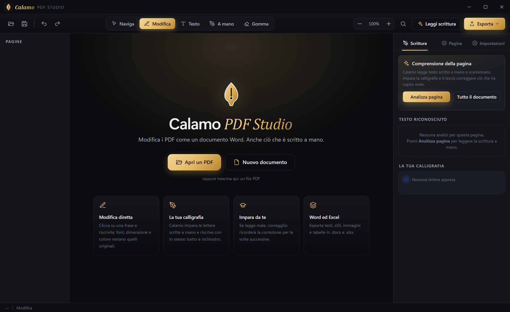

<p align="center">
  
</p>

<h1 align="center">Calamo PDF Studio</h1>
<p align="center"><b>Modifica i PDF come un documento Word. Anche ciò che è scritto a mano.</b></p>

<p align="center">
  <a href="../../releases/latest"></a>
  
  
</p>

<p align="center"></p>

## Cosa fa

| | |
|---|---|
| ✍️ **Modifica diretta del testo** | Clicca su una frase e riscrivila sul posto. Font, dimensione, colore, grassetti e corsivi restano quelli originali; i paragrafi vanno a capo da soli e vengono riscritte solo le righe che cambiano. |
| 🖋️ **Scrittura a mano con la tua calligrafia** | Calamo legge il testo scritto a mano, impara la forma delle lettere di chi ha scritto e riscrive le nuove frasi con lo stesso tratto, dimensione e colore d'inchiostro. |
| 🧠 **Impara dalle tue correzioni** | Se legge male una parola, scrivi cosa c'è davvero: la correzione viene ricordata e applicata in automatico le volte successive, e le lettere vengono ri-etichettate. |
| 🔠 **Segna lettere e numeri** | Indica tu dove si trova ogni lettera e ogni numero di una riga scritta a mano: questi caratteri hanno la precedenza, così la calligrafia della pagina diventa più completa. |
| 👥 **Più scritture sullo stesso foglio** | Calamo separa le righe di persone diverse (colore dell'inchiostro, spessore del tratto, inclinazione, dimensione) e i caratteri stampati: ogni riga viene riscritta solo con le lettere della sua scrittura, mai mescolate. Una scrittura si può rinominare, *ricordare* con un nome e usare su altre pagine o documenti quando lo scegli tu. |
| 🖨️ **Stampato identico alla scansione** | Lo stampato riscritto usa le lettere ritagliate dalla scansione stessa, con la stessa spaziatura, linea di base e dimensione; le lettere mancanti usano il font di sistema più simile, con lo stesso spessore e la stessa sfocatura. Resta cercabile. |
| 🔎 **Lettura più completa** | Una seconda lettura con contrasto migliorato recupera la scrittura chiara (matita, penne scariche, ombre delle foto); l'inchiostro che resta illeggibile viene segnalato in arancione per scriverne la lettura. |
| 🧭 **Tutti gli strumenti in un posto** | Il pulsante **Strumenti** (Ctrl+K) elenca tutto quello che Calamo sa fare, diviso per argomento e con una ricerca: scrivi "comprimi", "firma" o "word" e premi Invio. Ogni strumento mostra sotto la barra un suggerimento su come si usa. |
| 📝 **Moduli** | Compila i moduli PDF direttamente sulla pagina; crea campi di testo, caselle, scelte, menu a tendina e spazi per la firma; **Riconosci i campi** trasforma un modulo pensato per la carta (righe, puntini, caselle) in un modulo compilabile; appiattisci campi e commenti prima di inviarlo. |
| 🔏 **Firma digitale con certificato** | Firma PAdES con un certificato `.p12`/`.pfx` (anche nei campi firma già presenti), con marca temporale facoltativa; crea un certificato personale; verifica chi ha firmato e se il documento è stato modificato dopo la firma. |
| 🗄️ **PDF/A e verifica** | Copia PDF/A-2b per l'archiviazione (caratteri incorporati, profilo colore, metadati) e verifica del documento: requisiti PDF/A e accessibilità, con il pulsante per sistemare ogni punto. |
| ✂️ **Ritaglia e cambia formato** | Ritaglia trascinando un riquadro, togliendo dei millimetri o solo i margini bianchi; porta le pagine in A4, A3, A5, Lettera o Legale; più pagine per foglio (2, 4, 6, 9) e opuscoli da piegare. |
| 🔖 **Segnalibri e collegamenti** | Crea, rinomina e riordina i segnalibri, anche in automatico dai titoli; collegamenti a siti web o ad altre pagine, che si seguono con lo strumento Naviga. |
| 🗂️ **Schede e documenti affiancati** | Più PDF aperti insieme in schede; affiancane due e trascina le pagine dall'uno all'altro. |
| 🔍 **Rendi cercabile (OCR)** | Le scansioni (anche scritte a mano) ricevono un testo invisibile: il PDF si può cercare e copiare ovunque. |
| 🔁 **Converti** | Word, Excel, PowerPoint, immagini, pagine web e testo in PDF; PDF in Word, Excel, PowerPoint (testo modificabile), immagini PNG o JPG, pagina web e testo. |
| ▦ **Tabelle modificabili** | Cambia le celle, aggiungi o togli righe mantenendo l'aspetto della tabella. |
| 📐 **Guide e allineamento** | Guide magnetiche, griglia con righello, allinea e distribuisci più elementi. |
| 🌍 **Traduci** | Copia tradotta con la stessa impaginazione, anche delle parti scritte a mano. |
| 🔊 **Leggi e presenta** | Lettura ad alta voce con le voci di Windows e presentazione a schermo intero. |
| 📚 **Unisci e dividi PDF** | Unisci più PDF interi (anche solo alcune pagine di ciascuno) in un nuovo file con un segnalibro per file; dividi un PDF ogni N pagine, per intervalli, una pagina per file, per capitoli o per dimensione. |
| ✋ **Prendi e trascina** | Trascina ogni elemento della pagina: testi (con il loro carattere), tabelle e disegni (col loro testo), immagini, campi dei moduli, firme, note e forme; sulle scansioni anche scritte e grafica (timbri, loghi, riquadri), con la carta ricostruita sotto. |
| 📑 **Pagine** | Riordina trascinando le miniature, inserisci altri PDF, duplica, estrai pagine in un nuovo file. |
| 🖍️ **Annota** | Evidenzia, sottolinea e barra (anche la scrittura a mano letta), note, rettangoli, ellissi e frecce; tutti elencati nella scheda *Commenti*. |
| ✒️ **Firma e immagini** | Disegna la firma o prendila da una foto (lo sfondo viene tolto), inserisci immagini; sposta, ridimensiona, ritaglia e sostituisci. |
| ⬛ **Oscuramento sicuro** | Il testo sotto il riquadro nero viene eliminato davvero; ricerca automatica di codici fiscali, IBAN, email, telefoni, carte e nomi. |
| 🧾 **Documento** | Intestazione, piè di pagina, numeri di pagina, filigrana e numerazione Bates; proprietà (titolo, autore, lingua); confronto con un'altra versione; copia leggera; bianco e nero; copia protetta da password o senza password. |
| 🖨️ **Stampa** | Il pulsante della stampa offre tre scelte: *Stampa…* (Ctrl+P) con la finestra delle impostazioni e l'anteprima, *Stampa tutto subito* e *Stampa questa pagina subito* sulla stampante predefinita, senza finestre. |
| 📦 **Più file insieme** | Comprimi, numera, metti la filigrana, ruota, proteggi o togli la password, converti in PDF/A, appiattisci o ripara tanti PDF in un colpo. |
| 🩹 **Ripara** | Recupera i PDF danneggiati, pagina per pagina. |
| 🔄 **Aggiornamenti automatici** | Quando su GitHub esce una nuova versione, Calamo la scarica in background e la installa alla chiusura. |
| 📄 **Esporta in Word ed Excel** | `.docx` con stili, immagini, tabelle e testo scritto a mano; `.xlsx` con le tabelle in fogli formattati (numeri e percentuali riconosciuti). Le pagine scansionate vengono lette prima di esportarle: il testo diventa testo, le tabelle (anche disegnate a mano) tabelle vere, timbri e loghi immagini a parte; mai la pagina intera come un'unica immagine. |
| 🧰 **Tutto il resto** | Aggiungi testo, gomma per aree, trova e sostituisci, annulla/ripeti illimitato, ruota/inserisci/elimina pagine, tema scuro e chiaro, trascina e rilascia. |

<p align="center"></p>

## Installazione

1. Scarica **`CalamoPDF-Setup-<versione>.exe`** dalla pagina [Releases](../../releases/latest) e avvialo.
2. In alternativa usa la versione portabile: **`CalamoPDF.exe`**, sempre dalla pagina [Releases](../../releases/latest) — non richiede installazione.

> Windows potrebbe mostrare l'avviso SmartScreen perché l'eseguibile non è firmato: *Ulteriori informazioni → Esegui comunque*.

Requisiti: Windows 10/11 a 64 bit con WebView2 (già presente su Windows 11). Per il riconoscimento serve un pacchetto lingua di Windows con OCR (italiano e inglese di solito sono già installati).

## Come si usa

| Strumento | Tasto | |
|---|---|---|
| Modifica | `M` | Clicca un blocco di testo per modificarlo; `Ctrl+Invio` applica, `Esc` annulla. Clicca una riga scritta a mano per correggerne la lettura o riscriverla. Trascina un testo, una scritta, una tabella (dal bordo), un disegno, un'immagine o un campo per spostarli. |
| Testo | `T` | Clicca un punto della pagina e scrivi nuovo testo. |
| A mano | `H` | Clicca e scrivi: il testo viene composto con la calligrafia appresa dal documento. |
| Gomma | `E` | Trascina per cancellare un'area (utile sulle scansioni). |
| Segna scritta | `R` | Trascina un riquadro intorno a una scritta che Calamo non ha riconosciuto. |
| Annota | `A` | Trascina sul testo per evidenziare, sottolineare o barrare; clicca per una nota; trascina per rettangoli, ellissi e frecce. |
| Compila | `C` | Scrivi nei campi del modulo direttamente sulla pagina; *Riconosci i campi* li crea se il modulo è pensato per la carta. |
| Firma | `F` | Clicca dove mettere la firma (o un'immagine). La prima volta disegnala o prendila da una foto. Con *Digitale* trascina il riquadro della firma con certificato. |
| Oscura | `X` | Trascina sull'area da oscurare per sempre. |
| Oggetti | `O` | Prendi e trascina testi, scritte, tabelle, disegni, firme, immagini, campi, note e forme; ridimensiona dalla maniglia nell'angolo (anche testi, scritte e tabelle), `Canc` per eliminare; doppio clic su una nota per riscriverla. Una tabella con elementi dentro si prende dal bordo: ciò che contiene resta da prendere uno per uno. |
| Collegamenti | `L` | Trascina un riquadro sul testo e scegli un sito web o una pagina. |
| Ritaglia | `K` | Trascina il riquadro da tenere: il resto della pagina viene tagliato (questa pagina o tutte). |
| Crea campi | `Q` | Scegli il tipo di campo e trascina un riquadro sulla pagina. |

Gli strumenti meno usati (Oggetti, Gomma, Oscura, Collegamenti, Ritaglia, Crea campi, Segna scritta) sono nel menu **Altro** della barra. A destra i pannelli **Scrittura**, **Pagine**, **Moduli**, **Sicurezza**, **Documento** e **Commenti**: all'apertura compare quello adatto al documento (Scrittura per una scansione, Moduli per un modulo, Pagine per gli altri) finché non ne scegli uno tu e il pulsante in alto a destra (o `F6`) lo nasconde per lasciare tutto lo spazio alla pagina. Il **tasto destro** su una pagina o su una miniatura apre un menu con gli strumenti e le azioni su quella pagina. Le impostazioni e la guida sono nei pulsanti ⚙ e ? in alto.

**Scrittura a mano:** premi **Leggi scrittura** (o *Analizza pagina* nel pannello *Scrittura*). Le righe scritte a mano vengono colorate (un colore per persona), quelle stampate in grigio, quelle dubbie in rosso con un `?`, l'inchiostro non letto in arancione. Cliccando una riga puoi correggerne la lettura, scegliere a quale *scrittura* appartiene, dire se quella scrittura è *A mano* o *Stampata* (vale per tutte le sue righe) e aprire **Segna lettere**: ogni riquadro è un carattere, clicca un riquadro e digita la lettera o il numero (passa da solo al successivo), trascina i bordi per spostarli, *Dividi*/*Unisci* per correggere la segmentazione. Nel pannello *Scritture di questa pagina* scegli una scrittura per vederne le lettere (clicca una lettera per vederne gli esempi ed eliminare quelli sbagliati), rinominarla, *ricordarla* con un nome o completarla con una calligrafia ricordata (solo per le lettere che le mancano). Con lo strumento *A mano* puoi anche cliccare una scritta esistente per riscriverla.

Il pulsante **Strumenti** (Ctrl+K) raccoglie tutte le funzioni; se una funzione lavora su un documento e non ne è aperto nessuno, Calamo chiede prima quale PDF usare. Al primo avvio un breve tutorial spiega le funzioni principali (si può rivedere da *Impostazioni → Guida*).

## Come funziona

- **Testo digitale** — `PyMuPDF` estrae blocchi, righe e span con font e stile. Alla modifica il testo viene rimosso con una *redaction* mirata e riscritto con il font incorporato nel PDF (se contiene i glifi necessari) oppure con il font di sistema più simile.
- **Scrittura a mano** — l'OCR di Windows (`Windows.Media.Ocr`) fornisce una prima lettura; nelle parole fatte di cifre le lettere simili a numeri (`O`→`0`, `l`→`1`, `S`→`5`…) vengono corrette. Una seconda lettura su un'immagine con sfondo appiattito e contrasto aumentato aggiunge le parole mancate; l'inchiostro rimasto senza lettura diventa una riga "non letta". Per ogni riga si misurano colore dell'inchiostro, spessore del tratto, inclinazione, dimensione e un punteggio mano/stampa; le righe vengono raggruppate in *scritture* (persone o caratteri tipografici) e il tipo mano/stampa si decide per scrittura, così resta coerente. Ogni scrittura ha la sua libreria: lettere, parole intere e spaziature, misurate rispetto alla linea di base e all'altezza delle minuscole (non al riquadro della parola). Il nuovo testo riusa le parole e le sillabe già scritte da quella persona (con i collegamenti veri tra le lettere), poi le singole lettere, poi il font più simile per le mancanti; viene appoggiato sulla linea di base della riga originale, con la stessa altezza, dopo aver coperto l'originale ricostruendo la carta (ogni riga di pixel prosegue il colore trovato a sinistra e a destra, con la grana della scansione).
- **Lettore della scrittura a mano** — opzionale, scaricato al primo uso in `%APPDATA%\CalamoPDF\modelli`: TrOCR small handwritten (Microsoft, licenza MIT) in formato ONNX, eseguito con onnxruntime sulla CPU (su Windows con onnxruntime-directml: dalla 1.7.2, se c'è una scheda grafica DirectX 12 che calcola gli stessi numeri ed è chiaramente più veloce, il codificatore delle immagini a piena precisione `encoder_fp32.onnx` gira sulla scheda grafica, scelta misurata una volta in `scelta-scheda.json`). Dalla 1.7 si scarica anche una versione veloce del codificatore delle immagini (`encoder_fast.onnx`: le operazioni di ogni livello unite e i pesi a 8 bit per canale, costruita da `tools/make_fast_model.py` e pubblicata dal workflow *Fast model*); le righe di una pagina vengono lette in anticipo da più lettori in parallelo, e le lettere della calligrafia si imparano dopo che il testo è comparso. Ogni riga a mano viene ripulita (inchiostro nero su bianco) e letta per intero; tra lettura OCR e lettura del modello, corrette con il dizionario italiano (`app/engine/data/it_words.txt`, da FrequencyWords/OpenSubtitles, CC BY-SA 4.0), vince quella più sensata in italiano. Le scansioni storte vengono raddrizzate prima dell'OCR.
- **Strumenti PDF** — moduli, ritaglio, formato, segnalibri, collegamenti, PDF/A ed esportazione in PowerPoint sono fatti con `PyMuPDF` (`app/engine/pdftools.py`); la firma digitale PAdES e la sua verifica con `pyHanko` (`app/engine/signing.py`): la firma viene aggiunta come aggiornamento incrementale, così le firme già presenti restano valide. Il PDF/A-2b viene creato riscrivendo con caratteri installati il testo in caratteri non incorporati, con il profilo colore sRGB e i metadati XMP; la verifica interna controlla i requisiti principali (per una certificazione formale serve un validatore come veraPDF).
- **Memoria** — correzioni di lettura, calligrafie ricordate per nome (`calligrafie.json`) e impostazioni sono salvate in `%APPDATA%\CalamoPDF`. Le lettere apprese da una pagina non vengono salvate da sole.
- **Pagine ruotate** — le scansioni da telefono hanno spesso `/Rotate` e un cropbox spostato: le coordinate mostrate a schermo (e lette dall'OCR) vengono convertite in quelle della pagina con la stessa trasformazione che MuPDF usa per il rendering, così le modifiche finiscono esattamente dove le vedi.
- **Aggiornamenti** — all'avvio l'app legge l'ultima release di GitHub; se è più recente scarica l'installer (copia installata) o il nuovo `CalamoPDF.exe` (copia portabile) e lo applica dopo la chiusura.

## Pubblicare una nuova versione

1. Aggiorna `VERSION` in `app/main.py` (e `version_info.txt`).
2. Crea e invia il tag: `git tag v1.1.0 && git push origin v1.1.0`.
3. Il workflow *Release* compila `CalamoPDF.exe` e l'installer e li pubblica nella release: le app già installate si aggiornano da sole.

## Sviluppo

```powershell
py -3.12 -m venv .venv
.\.venv\Scripts\pip install -r requirements.txt
.\.venv\Scripts\python app\main.py            # avvia l'app
.\.venv\Scripts\python tools\smoke_test.py    # test del motore
.\.venv\Scripts\python tools\eval_handwriting.py pagina.png --truth testo.txt   # misura lettura e riscrittura
.\build.ps1                                   # crea CalamoPDF.exe e l'installer (Inno Setup 6)
```

Struttura: `app/engine` (motore PDF, OCR, calligrafia, esportazione), `app/ui` (interfaccia HTML/CSS/JS in WebView2 tramite pywebview), `tools/` (build, test, server di sviluppo).

## Licenza

[GNU AGPL-3.0](LICENSE) — il progetto usa PyMuPDF/MuPDF, distribuiti con la stessa licenza.
